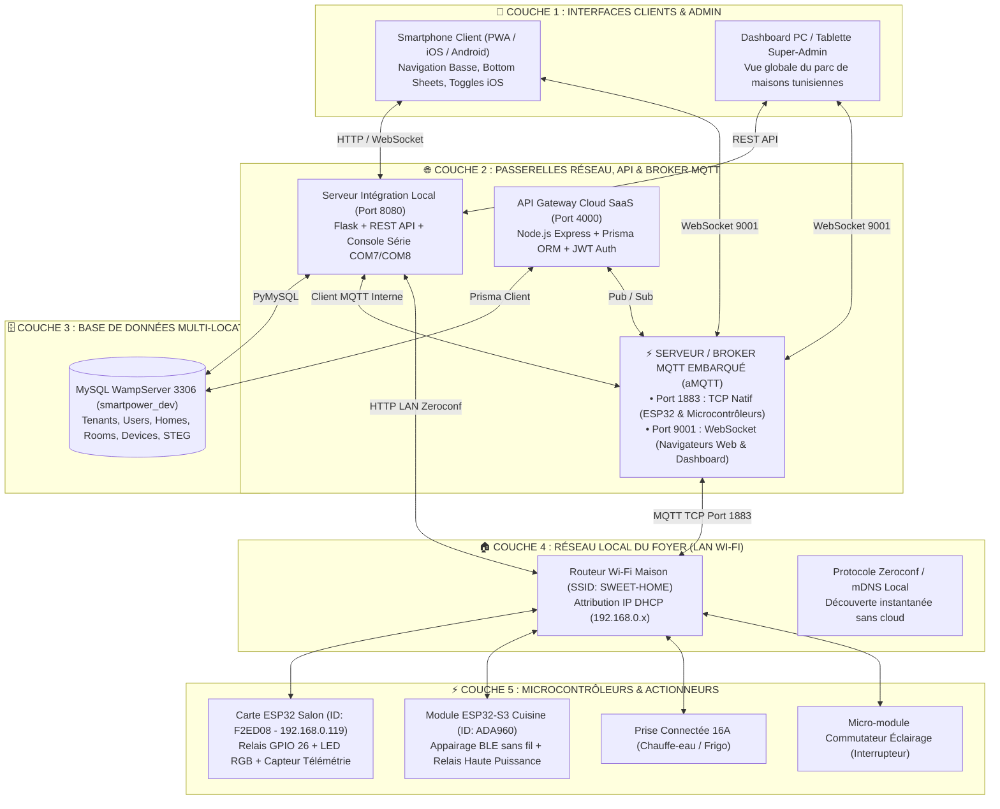
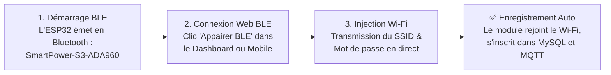
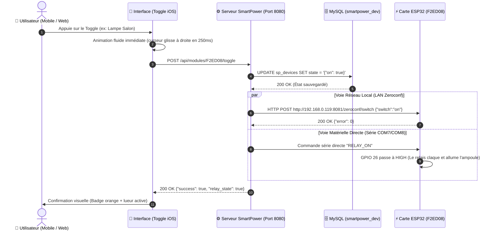
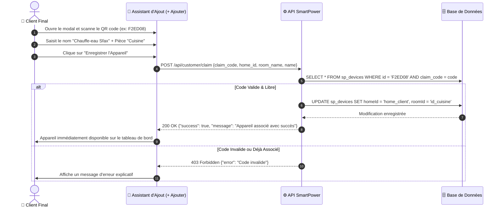
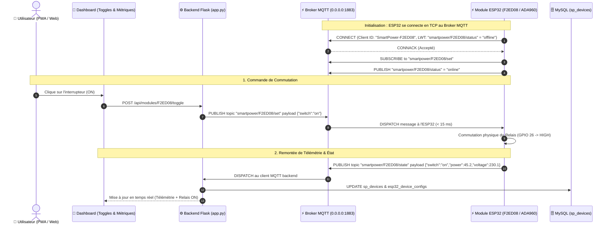

# ⚡ SmartPower — Architecture Complète du Système & Manuel de Fonctionnement

> **Plateforme Domotique & Suivi Énergétique Multi-Locataire (Alternative Tunisienne & Souveraine à Sonoff / eWeLink)**  
> **Auteur :** Antigravity & SmartPower Team  
> **Date de mise à jour :** 2026-10-27  
> **Environnement :** Production / Dev hybride (Cloud SaaS + Broker MQTT Embarqué + Passerelle Locale + Microcontrôleur ESP32)

---

## 📑 Sommaire
1. [Vue d'Ensemble & Comparatif Sonoff](#1-vue-densemble--comparatif-sonoff)
2. [Architecture Technique Globale (Schéma 5 Niveaux)](#2-architecture-technique-globale)
3. [Comment Fonctionne le Système (Les 5 Piliers)](#3-comment-fonctionne-le-système)
   - [A. La Communication Wi-Fi (Topologie Étoile, LAN Zeroconf & Cloud MQTT)](#a-la-communication-wi-fi)
   - [B. Le Cycle d'Appairage Sans Fil (BLE & QR Code en 30s)](#b-le-cycle-dappairage-sans-fil-ble--qr-code-en-30s)
   - [C. L'Architecture Multi-Tenant (Super-Admin vs Espace Client)](#c-larchitecture-multi-tenant)
   - [D. Le Moteur Énergétique & Facturation STEG Tunisie](#d-le-moteur-énergétique--facturation-steg-tunisie)
   - [E. Le Serveur / Broker MQTT Embarqué & Pub/Sub Temps Réel](#e-le-serveur--broker-mqtt-embarqué--pubsub-temps-réel)
4. [Schéma de la Base de Données Relationnelle (MySQL)](#4-schéma-de-la-base-de-données-relationnelle)
5. [Diagrammes de Séquence des Flux Fonctionnels](#5-diagrammes-de-séquence-des-flux-fonctionnels)
   - [Flux 1 : Commutation d'une Lampe ou d'une Prise (Mode Hybride LAN/Série)](#flux-1--commutation-dune-lampe-ou-dune-prise)
   - [Flux 2 : Association (Claiming) d'un Nouvel Appareil](#flux-2--association-claiming-dun-nouvel-appareil)
   - [Flux 3 : Télécommande et Télémétrie Instantanée via le Broker MQTT (Port 1883)](#flux-3--télécommande-et-télémétrie-instantanée-via-le-broker-mqtt-port-1883)
6. [Structure des Fichiers du Projet](#6-structure-des-fichiers-du-projet)
7. [Résumé des Points Clés pour l'Exploitation](#7-résumé-des-points-clés-pour-lexploitation)

---

## 1. Vue d'Ensemble & Comparatif Sonoff

La plateforme SmartPower reproduit et dépasse le modèle industriel de **Sonoff / eWeLink (CoolKit)** en apportant la **souveraineté locale**, la gestion des **Dinars Tunisiens (TND)**, un **Broker MQTT intégré** et les tarifs officiels de la **STEG** :

| Critère | Écosystème Sonoff / eWeLink | Plateforme SmartPower (Notre Système) |
| :--- | :--- | :--- |
| **Puce Matérielle** | ESP8266 / ESP32-C3 | **ESP32 & ESP32-S3 Dual-Core** (Wi-Fi 2.4 GHz + BLE) |
| **Broker MQTT** | Serveurs Cloud fermés CoolKit | **Broker MQTT Intégré (Port 1883 TCP + 9001 WebSocket) + Cloud souverain** |
| **Souveraineté des Données** | Serveurs AWS / Chine (CoolKit) | **Serveurs dédiés souverains (Tunisie / OVH / Local)** |
| **Résilience Hors-Ligne** | Bloqué si coupure internet (hors DIY) | **Mode Triple : MQTT local + Zeroconf mDNS direct + Liaison Série USB** |
| **Suivi Énergétique** | Basique sur POWR2 / POWR3 | **Calculateur par paliers STEG Tunisie (0.181 à 0.419 DT/kWh)** |
| **Isolation Multi-Clients** | 1 compte = 1 email | **Multi-Tenant : Super-Admin national + Maisons clients isolées** |
| **Tarification & Devises** | USD ($) / EUR (€) | **Dinars Tunisiens (TND / DT) intégrés d'origine** |
| **Interface Tactile** | Application mobile propriétaire | **Web App Responsive PWA + Mobile First (Toggles iOS, Bottom Nav)** |

---

## 2. Architecture Technique Globale

Le système repose sur une pile 5 couches garantissant haute disponibilité, latence minimale (< 20 ms) et indépendance face aux pannes internet.



---

## 3. Comment Fonctionne le Système

### A. La Communication Wi-Fi
Les modules connectés (comme la carte ESP32 `F2ED08` ou ESP32-S3 `ADA960`) ne nécessitent aucun câblage réseau.
1. **Topologie en Étoile :**  
   Chaque module se connecte directement au **Routeur Wi-Fi 2.4 GHz de la maison** (`SWEET-HOME`). Il reçoit une adresse IP locale (ex : `192.168.0.119`).
2. **Triple Voie de Commande (Résilience Totale) :**
   - **Voie 1 - Broker MQTT (Temps Réel & Faible Latence) :**  
     Le module maintient une connexion TCP permanente sur le port `1883` avec le Broker MQTT. Toute commande de commutation est acheminée en moins de 15 ms.
   - **Voie 2 - LAN Zeroconf Local (Secours direct sans broker) :**  
     Chaque module embarque un mini-serveur HTTP interne (`/zeroconf/switch`). Même si le broker ou internet est indisponible, l'application continue de piloter les lampes et prises via des requêtes HTTP directes.
   - **Voie 3 - Liaison Série USB (Maintenance & Labo) :**  
     Pour le diagnostic et le secours matériel immédiat, la liaison série USB CDC (`COM7` ou `COM8`) permet une commande directe.

---

### B. Le Cycle d'Appairage Sans Fil (BLE & QR Code en 30s)
Pour garantir qu'un installateur ou client final puisse configurer son équipement sans aucun câble :



1. **Bluetooth Low Energy (BLE) :** Le module s'annonce comme service GATT `4fafc201-1fb5-459e-8fcc-c5c9c331914b`.
2. **Web Bluetooth API :** Le dashboard web (Google Chrome / Edge / Mobile) dialogue directement avec le microcontrôleur via le navigateur.
3. **Persistance en EEPROM / NVS :** Les identifiants Wi-Fi sont stockés de manière permanente dans la mémoire flash de l'ESP32.
4. **Auto-Enregistrement :** Dès qu'il a son adresse IP, le module s'auto-enregistre auprès du serveur Flask via `/api/modules/register` et rejoint le broker MQTT.

---

### C. L'Architecture Multi-Tenant (Super-Admin vs Client)
Le système garantit une **étanchéité stricte** des données :
- **Super-Administrateur (SmartPower) :**
  - Visualise l'ensemble du parc national déployé en Tunisie (`Villa La Marsa`, `Appartement Ennasr 2`, `Maison Hammamet`, `Villa Sfax`).
  - Suit le nombre total de modules en ligne, l'état matériel des cartes, l'état du broker MQTT et les facturations globales.
- **Utilisateur Client (Ex : Propriétaire de la Villa La Marsa) :**
  - Ne voit **strictement que ses propres pièces** (`Salon`, `Chambre`, `Cuisine`, `Extérieur`) et ses propres modules.
  - Aucune maison voisine n'est accessible ni visible.

---

### D. Le Moteur Énergétique & Facturation STEG Tunisie
Contrairement aux solutions étrangères qui affichent des dollars ou des euros, SmartPower intègre le barème officiel de la **Société Tunisienne de l'Électricité et du Gaz (STEG)** en Dinars Tunisiens (DT / TND) :

$$\text{Facture Estimée} = \text{Redevance Fixe} + \sum (\text{kWh consommés} \times \text{Tarif Palier}) + \text{Taxes}$$

- **Palier 1 (0 à 200 kWh / mois) :** `0.181 DT / kWh` (Tarif économique social)
- **Palier 2 (201 à 300 kWh / mois) :** `0.223 DT / kWh`
- **Palier 3 (301 à 500 kWh / mois) :** `0.338 DT / kWh`
- **Palier 4 (> 500 kWh / mois) :** `0.419 DT / kWh` (Tarif de pointe)
- **Frais fixes :** Redevance mensuelle de `2.500 DT` + TVA 7% + Taxe RTT `0.005 DT/kWh`.

Le moteur calcule en direct la puissance active instantanée en Watts (ex : `1 450 W`) et projette le coût mensuel pour éviter les surprises sur la facture.

---

### E. Le Serveur / Broker MQTT Embarqué & Pub/Sub Temps Réel

Le serveur MQTT est l'épine dorsale de communication de l'écosystème SmartPower. Il permet des communications asynchrones, bidirectionnelles et ultra-légères.

#### 1. Pourquoi MQTT au Cœur de SmartPower ?
- **Empreinte Réseau Minimale :** L'en-tête d'un paquet MQTT ne pèse que **2 octets**, contre plus de 500 octets pour une requête HTTP complète. Idéal pour économiser la bande passante Wi-Fi et les liaisons 4G/3G.
- **Connexion Persistante (Keep-Alive) :** Les modules ESP32 maintiennent un canal TCP ouvert en continu. Aucun polling n'est nécessaire.
- **Télémétrie en Push Instantané :** Dès qu'un capteur de courant mesure une surconsommation, la trame est poussée au serveur en moins de 10 ms.
- **Last Will and Testament (LWT) :** À la connexion, chaque module enregistre un "testament". Si la carte subit une panne de courant ou perd le Wi-Fi, le Broker publie automatiquement `smartpower/{deviceId}/status = "offline"`, alertant le Dashboard instantanément.

#### 2. Ports d'Écoute du Broker SmartPower
| Port | Protocole | Usage Principal |
| :--- | :--- | :--- |
| **`1883`** | **MQTT TCP Standard** | Connexion des microcontrôleurs (ESP32, ESP32-S3, modules relais, prises) |
| **`9001`** | **MQTT WebSockets** | Connexion directe depuis les navigateurs web, dashboards temps réel et apps mobiles |
| **`8883`** (Option Cloud) | **MQTTS (TLS / SSL)** | Chiffrement pour le déploiement Cloud distant en environnement de production |

#### 3. Spécification Officielle des Topics & Formats JSON
Tous les flux d'échanges obéissent à une nomenclature normalisée :

| Rôle du Topic | Format du Topic | Exemple de Payload JSON | Émetteur / Destinataire |
| :--- | :--- | :--- | :--- |
| **Commande Actionneur** | `smartpower/{deviceId}/set` | `{"switch": "on"}` ou `{"switch": "off"}` | Dashboard/Backend ➔ ESP32 |
| **Retour d'État & Télémétrie** | `smartpower/{deviceId}/state` | `{"switch":"on","power":45.2,"voltage":230.1,"current":0.196,"energy":1.258}` | ESP32 ➔ Broker / Dashboard |
| **Présence / LWT** | `smartpower/{deviceId}/status` | `"online"` / `"offline"` | Broker & ESP32 ➔ Système |
| **Configuration à Distance** | `smartpower/{deviceId}/config` | `{"report_interval": 5, "led_color": "#f97316"}` | Super-Admin ➔ ESP32 |

#### 4. Implémentation du Broker dans SmartPower (`dashboard/mqtt_service.py`)
Le Broker est nativement intégré dans l'application via le moteur Python asynchrone `amqtt` :
- **Autonome & Zéro Dépendance :** Ne nécessite aucun serveur externe tel que Mosquitto. Il se lance automatiquement avec le serveur Flask.
- **Client Backend Intégré :** Un client `paho-mqtt` écoute le topic global `smartpower/#`. Dès qu'un message d'état arrive :
  1. Il met à jour la table MySQL `sp_devices` et `esp32_device_configs`.
  2. Il synchronise l'état physique du relais sans rechargement de page.
  3. Il met à disposition les métriques sur l'API `/api/mqtt/status`.

---

## 4. Schéma de la Base de Données Relationnelle

Le modèle de données relationnel MySQL (`smartpower_dev`) garantit l'intégrité référentielle :

```
┌─────────────────────────────────┐
│           sp_users              │
├─────────────────────────────────┤
│ id (PK, VARCHAR)                │
│ email (UNIQUE)                  │
│ password (HASH)                 │
│ name (VARCHAR)                  │
│ role (ADMIN / CUSTOMER)         │
└────────────────┬────────────────┘
                 │ 1
                 │
                 │ *
┌────────────────┴────────────────┐
│           sp_homes              │
├─────────────────────────────────┤
│ id (PK, VARCHAR)                │
│ name (ex: Villa La Marsa)       │
│ city (Tunis, Sousse, Sfax...)   │
│ currency (TND)                  │
│ tariffPerKwh (0.181)            │
└───────┬─────────────────┬───────┘
        │ 1               │ 1
        │                 │
        │ *               │ *
┌───────┴────────┐ ┌──────┴───────────────┐
│   sp_rooms     │ │     sp_devices       │
├────────────────┤ ├──────────────────────┤
│ id (PK)        │ │ id (PK, ex: F2ED08)  │
│ homeId (FK)    │ │ homeId (FK)          │
│ name (Salon)   │ │ roomId (FK)          │
│ icon (sofa)    │ │ name (Lampe Salon)   │
└────────────────┘ │ type (SWITCH / PLUG) │
                   │ claim_code (SECRET)  │
                   │ is_online (BOOLEAN)  │
                   │ state (JSON : ON/OFF)│
                   └──────────────────────┘
```

---

## 5. Diagrammes de Séquence des Flux Fonctionnels

### Flux 1 : Commutation d'une Lampe ou d'une Prise
Ce flux illustre ce qui se passe lorsque l'utilisateur appuie sur un commutateur (**toggle**) sur son smartphone :



---

### Flux 2 : Association (Claiming) d'un Nouvel Appareil



---

### Flux 3 : Télécommande et Télémétrie Instantanée via le Broker MQTT (Port 1883)

Ce flux décrit le cycle complet de commande et de télémétrie asynchrone temps réel via MQTT :



---

## 6. Structure des Fichiers du Projet

```
C:\Users\yassin\Desktop\SmartPower\
│
├── dashboard\                       # Interface Web / Mobile & Serveurs d'Intégration
│   ├── app.py                       # Point d'entrée de l'application Flask (Port 8080)
│   ├── mqtt_service.py              # Broker MQTT aMQTT (Ports 1883/9001) + Client Paho
│   ├── mysql_manager.py             # Moteur CRUD MySQL & Routage matériel
│   ├── network_discovery.py         # Découverte automatique des modules sur le LAN
│   └── templates\
│       └── index.html               # Frontend PWA (Toggles iOS, Bottom Nav, Radar BLE, Badge MQTT)
│
├── backend\                         # Coeur Cloud SaaS Haute Échelle
│   ├── prisma\
│   │   └── schema.prisma            # Définition formelle des modèles relationnels
│   ├── src\
│   │   ├── api\                     # Contrôleurs REST & Routes sécurisées
│   │   ├── mqtt\                    # Broker MQTT Aedes & Gestionnaires de paquets
│   │   └── services\                # Moteur STEG, Facturation, Multi-Tenant
│   └── package.json
│
├── firmware\                        # Code Embarqué C++ Arduino / ESP32
│   └── esp32_smartpower_dashboard\
│       └── esp32_smartpower_dashboard.ino  # Firmware BLE + Wi-Fi + mDNS + Relais + MQTT Client
│
└── docs\                            # Spécifications & Architecture
    ├── SAAS_ARCHITECTURE.md         # Le présent document d'architecture
    └── DEVICE_PROTOCOL_SPEC.md      # Spécification détaillée des trames réseau & MQTT
```

---

## 7. Résumé des Points Clés pour l'Exploitation

1. **Serveur d'Application & Dashboard :** Le serveur Flask tourne sur le port `8080`, relié à MySQL WampServer sur le port `3306`.
2. **Serveur / Broker MQTT Embarqué :**
   - Écoute active sur le port **`1883`** (TCP) pour tous les modules ESP32 et ESP32-S3.
   - Écoute active sur le port **`9001`** (WebSocket) pour les interfaces web.
   - Statut consultable en direct via l'API [`/api/mqtt/status`](http://localhost:8080/api/mqtt/status) et visualisable via le badge supérieur du tableau de bord.
3. **Pour accéder à l'interface :**
   - Sur l'ordinateur : [`http://localhost:8080`](http://localhost:8080)
   - Sur smartphone/tablette : `http://172.16.50.138:8080` (accessible sur le réseau Wi-Fi).
4. **Appairage Sans Fil (BLE) :** Le bouton `📱 Appairer BLE` en haut permet d'ajouter n'importe quel ESP32-S3 vierge sans jamais brancher de câble USB.
5. **Multi-tenancy :** Le menu *Profils* en haut permet de basculer instantanément entre la supervision Super-Admin et la vue isolée d'un client.
6. **Tarification :** Tous les calculs s'opèrent en **Dinars Tunisiens (TND)** selon la grille officielle progressive de la STEG.
