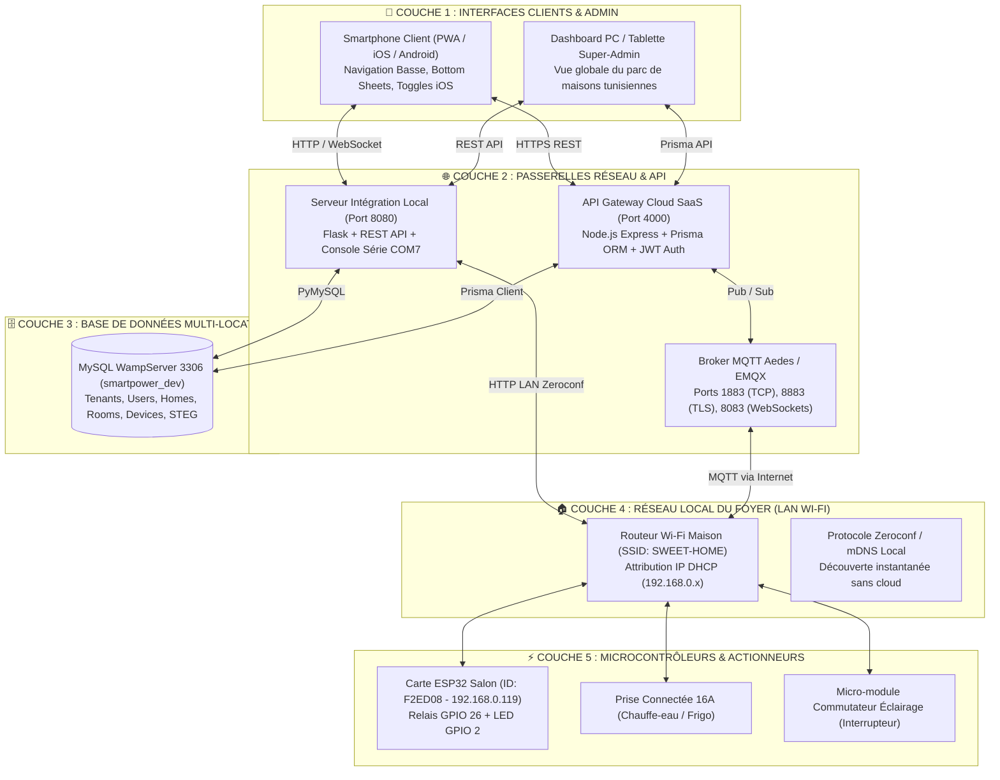
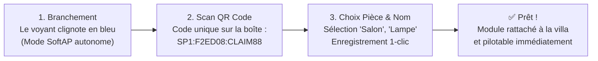
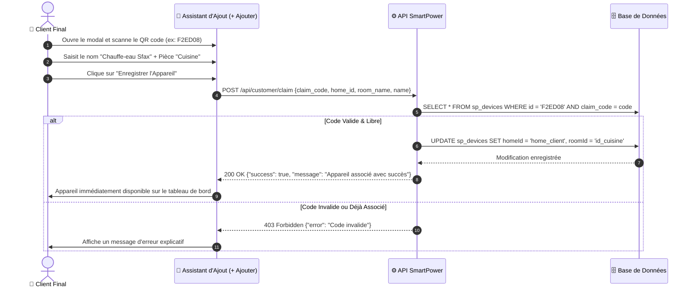

# ⚡ SmartPower — Architecture Complète du Système & Manuel de Fonctionnement

> **Plateforme Domotique & Suivi Énergétique Multi-Locataire (Alternative Tunisienne & Souveraine à Sonoff / eWeLink)**  
> **Auteur :** Antigravity & SmartPower Team  
> **Date de mise à jour :** 2026-10-25  
> **Environnement :** Production / Dev hybride (Cloud SaaS + Passerelle Locale + Microcontrôleur ESP32)

---

## 📑 Sommaire
1. [Vue d'Ensemble & Comparatif Sonoff](#1-vue-densemble--comparatif-sonoff)
2. [Architecture Technique Globale (Schéma 5 Niveaux)](#2-architecture-technique-globale)
3. [Comment Fonctionne le Système (Les 4 Piliers)](#3-comment-fonctionne-le-système)
   - [A. La Communication Wi-Fi (Topologie Étoile, LAN Zeroconf & Cloud MQTT)](#a-la-communication-wi-fi)
   - [B. Le Cycle d'Appairage Ultra-Simple en 30s (Onboarding Client)](#b-le-cycle-dappairage-client-en-30s)
   - [C. L'Architecture Multi-Tenant (Super-Admin vs Espace Client)](#c-larchitecture-multi-tenant)
   - [D. Le Moteur Énergétique & Facturation STEG Tunisie](#d-le-moteur-énergétique--facturation-steg-tunisie)
4. [Schéma de la Base de Données Relationnelle (MySQL)](#4-schéma-de-la-base-de-données-relationnelle)
5. [Diagrammes de Séquence des Flux Fonctionnels](#5-diagrammes-de-séquence-des-flux-fonctionnels)
   - [Flux 1 : Commutation d'une Lampe ou d'une Prise](#flux-1--commutation-dune-lampe-ou-dune-prise)
   - [Flux 2 : Association (Claiming) d'un Nouvel Appareil](#flux-2--association-claiming-dun-nouvel-appareil)
6. [Structure des Fichiers du Projet](#6-structure-des-fichiers-du-projet)

---

## 1. Vue d'Ensemble & Comparatif Sonoff

La plateforme SmartPower reproduit et dépasse le modèle industriel de **Sonoff / eWeLink (CoolKit)** en apportant la **souveraineté locale**, la gestion des **Dinars Tunisiens (TND)** et les tarifs officiels de la **STEG** :

| Critère | Écosystème Sonoff / eWeLink | Plateforme SmartPower (Notre Système) |
| :--- | :--- | :--- |
| **Puce Matérielle** | ESP8266 / ESP32-C3 | **ESP32 & ESP32-S3 Dual-Core** (Wi-Fi 2.4 GHz + BLE) |
| **Souveraineté des Données** | Serveurs CoolKit / AWS (Chine / US) | **Serveurs dédiés souverains (Tunisie / OVH / Local)** |
| **Résilience Hors-Ligne** | Bloqué si coupure internet (hors LAN DIY) | **Mode Hybride Automatique (Zeroconf mDNS LAN direct + Cloud MQTT)** |
| **Suivi Énergétique** | Basique sur POWR2 / POWR3 | **Calculateur par paliers STEG Tunisie (0.181 à 0.419 DT/kWh)** |
| **Isolation Multi-Clients** | 1 compte = 1 email | **Multi-Tenant : Super-Admin national + Maisons clients isolées** |
| **Tarification & Devises** | USD ($) / EUR (€) | **Dinars Tunisiens (TND / DT) intégrés d'origine** |
| **Interface Tactile** | Application mobile propriétaire | **Web App Responsive PWA + Mobile First (Toggles iOS, Bottom Nav)** |

---

## 2. Architecture Technique Globale

Le système repose sur une pile 5 couches garantissant haute disponibilité, latence minimale (< 50 ms) et indépendance face aux pannes internet.



---

## 3. Comment Fonctionne le Système

### A. La Communication Wi-Fi
Les modules connectés (comme la carte ESP32 `F2ED08`) ne nécessitent aucun câblage réseau.
1. **Topologie en Étoile :**  
   Chaque module se connecte directement au **Routeur Wi-Fi 2.4 GHz de la maison** (`SWEET-HOME`). Il reçoit une adresse IP locale (ex : `192.168.0.119`).
2. **Double Voie de Commande (Hybride) :**
   - **Voie 1 - Cloud MQTT (Accès Partout dans le Monde) :**  
     Le module maintient une connexion TCP sécurisée avec le Broker MQTT (`smartpower/device/{deviceId}/state`). Dès que le client commute un appareil depuis la 4G, le broker transmet l'ordre en moins de 30 ms.
   - **Voie 2 - LAN Zeroconf Local (Résilience en cas de coupure Internet) :**  
     Exactement comme Sonoff DIY, chaque module embarque un serveur HTTP interne (`/zeroconf/switch`). Si la connexion internet est coupée, l'application continue de piloter les lumières et prises sur le réseau local via Wi-Fi.

### B. Le Cycle d'Appairage Client en 30s
Pour garantir qu'un client non-technicien puisse installer son équipement en 30 secondes chrono :



1. **À la fabrication :** Chaque module reçoit un `Device ID` matériel (ex: `F2ED08`) et un code secret `claim_code`.
2. **À l'installation :** Le client clique sur **`+ Ajouter`** dans son interface, saisit le code ou scanne le QR code, donne un nom (`Chauffe-eau`) et choisit la pièce (`Cuisine`).
3. **Dans la base :** Le système vérifie que le code est valide, associe l'ID à la maison du client (`homeId`) et configure le relais physique.

### C. L'Architecture Multi-Tenant (Super-Admin vs Client)
Le système garantit une **étanchéité stricte** des données :
- **Super-Administrateur (SmartPower) :**
  - Visualise l'ensemble du parc national déployé en Tunisie (`Villa La Marsa`, `Appartement Ennasr 2`, `Maison Hammamet`, `Villa Sfax`).
  - Suit le nombre total de modules en ligne, l'état matériel des cartes, et les facturations globales.
- **Utilisateur Client (Ex : Propriétaire de la Villa La Marsa) :**
  - Ne voit **strictement que ses propres pièces** (`Salon`, `Chambre`, `Cuisine`, `Extérieur`) et ses propres modules.
  - Aucune maison voisine n'est accessible ni visible.

### D. Le Moteur Énergétique & Facturation STEG Tunisie
Contrairement aux solutions chinoises qui affichent des dollars ou des euros, SmartPower intègre le barème officiel de la **Société Tunisienne de l'Électricité et du Gaz (STEG)** en Dinars Tunisiens (DT / TND) :

$$\text{Facture Estimée} = \text{Redevance Fixe} + \sum (\text{kWh consommés} \times \text{Tarif Palier}) + \text{Taxes}$$

- **Palier 1 (0 à 200 kWh / mois) :** `0.181 DT / kWh` (Tarif économique social)
- **Palier 2 (201 à 300 kWh / mois) :** `0.223 DT / kWh`
- **Palier 3 (301 à 500 kWh / mois) :** `0.338 DT / kWh`
- **Palier 4 (> 500 kWh / mois) :** `0.419 DT / kWh` (Tarif de pointe)
- **Frais fixes :** Redevance mensuelle de `2.500 DT` + TVA 7% + Taxe RTT `0.005 DT/kWh`.

Le moteur calcule en direct la puissance active instantanée en Watts (ex : `1 450 W`) et projette le coût mensuel pour éviter les surprises sur la facture.

---

## 4. Schéma de la Base de Données Relationnelle

Le modèle de données relationnel MySQL (`smartpower_dev`) garantit l'intégrité référentielle :

```
┌─────────────────────────────────┐
│           sp_users              │
├─────────────────────────────────┤
│ id (PK, VARCHAR)                │
│ email (UNIQUE)                  │
│ password (HASH)                 │
│ name (VARCHAR)                  │
│ role (ADMIN / CUSTOMER)         │
└────────────────┬────────────────┘
                 │ 1
                 │
                 │ *
┌────────────────┴────────────────┐
│           sp_homes              │
├─────────────────────────────────┤
│ id (PK, VARCHAR)                │
│ name (ex: Villa La Marsa)       │
│ city (Tunis, Sousse, Sfax...)   │
│ currency (TND)                  │
│ tariffPerKwh (0.181)            │
└───────┬─────────────────┬───────┘
        │ 1               │ 1
        │                 │
        │ *               │ *
┌───────┴────────┐ ┌──────┴───────────────┐
│   sp_rooms     │ │     sp_devices       │
├────────────────┤ ├──────────────────────┤
│ id (PK)        │ │ id (PK, ex: F2ED08)  │
│ homeId (FK)    │ │ homeId (FK)          │
│ name (Salon)   │ │ roomId (FK)          │
│ icon (sofa)    │ │ name (Lampe Salon)   │
└────────────────┘ │ type (SWITCH / PLUG) │
                   │ claim_code (SECRET)  │
                   │ is_online (BOOLEAN)  │
                   │ state (JSON : ON/OFF)│
                   └──────────────────────┘
```

---

## 5. Diagrammes de Séquence des Flux Fonctionnels

### Flux 1 : Commutation d'une Lampe ou d'une Prise
Ce flux illustre ce qui se passe lorsque l'utilisateur appuie sur un commutateur (**toggle**) sur son smartphone :


---

### Flux 2 : Association (Claiming) d'un Nouvel Appareil



---

## 6. Structure des Fichiers du Projet

```
C:\Users\yassin\Desktop\SmartPower\
│
├── dashboard\                       # Interface Web / Mobile & Serveur Flask
│   ├── app.py                       # Point d'entrée de l'application (Port 8080)
│   ├── mysql_manager.py             # Moteur CRUD MySQL & Routage matériel
│   └── templates\
│       └── index.html               # Frontend PWA (Toggles iOS, Bottom Nav, Assistant IA)
│
├── backend\                         # Coeur Cloud SaaS Haute Échelle
│   ├── prisma\
│   │   └── schema.prisma            # Définition formelle des modèles relationnels
│   ├── src\
│   │   ├── api\                     # Contrôleurs REST & Routes sécurisées
│   │   ├── mqtt\                    # Broker MQTT Aedes & Gestionnaires de paquets
│   │   └── services\                # Moteur STEG, Facturation, Multi-Tenant
│   └── package.json
│
├── firmware\                        # Code Embarqué C++ Arduino / ESP32
│   └── esp32_smartpower_dashboard\
│       └── esp32_smartpower_dashboard.ino  # Firmware Wi-Fi, mDNS Zeroconf, Relais GPIO 26
│
└── docs\                            # Spécifications & Architecture
    ├── SAAS_ARCHITECTURE.md         # Le présent document d'architecture
    └── DEVICE_PROTOCOL_SPEC.md      # Spécification détaillée des trames réseau
```

---

## 7. Résumé des Points Clés pour l'Exploitation

1. **Pour lancer le système :** Le serveur Flask tourne sur le port `8080`, relié à MySQL WampServer sur le port `3306`.
2. **Pour accéder à l'interface :**
   - Sur l'ordinateur : [`http://localhost:8080`](http://localhost:8080)
   - Sur le smartphone : `http://10.124.209.239:8080` (accessible sur tout appareil connecté au Wi-Fi).
3. **Multi-tenancy :** Le menu *Profils* en haut permet de basculer instantanément entre la supervision Super-Admin et la vue isolée d'un client.
4. **Tarification :** Tous les calculs s'opèrent en **Dinars Tunisiens (TND)** selon la grille officielle progressive de la STEG.
